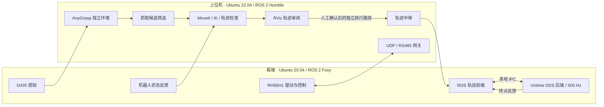

# Unitree G1-D Grasp

**宇树 G1-D 真实机器人抓取：AnyGrasp 感知、MoveIt 规划与终点反馈控制。**

[](https://github.com/1720d8eaff/unitree-g1d-grasp/actions/workflows/ci.yml)


A hardware-oriented manipulation stack for Unitree G1-D, integrating RGB-D perception, AnyGrasp candidate selection, MoveIt planning, an isolated ROS 2 / Unitree DDS trajectory bridge, and RH56H1 hand control.

本仓库聚焦真机感知与执行工程，以及失败表征和异步动作管理组件；配套的 [FailureVLA](https://github.com/1720d8eaff/FailureVLA) 仓库提供操作轨迹和状态历史预测基线。

独立的物体中心容器操作项目见 [ContainerLoop-VLA](https://github.com/1720d8eaff/ContainerLoop-VLA)。

`integrations/failurevla_bridge.py` 提供策略与机器人系统之间的回调式接口：刷新观测后，依据候选评分、碰撞与可达性检查选择规划结果。该接口复用调用方提供的感知、规划和执行能力，执行回调须显式配置。验证范围见 [简历证据索引](docs/RESUME_EVIDENCE.md)。

本仓库整理自 **2026-09-11 v0.3.14 开发交接快照**。采用板端与上位机分离的工程结构，保留原始控制源码、参考数据和完整性检查；历史日志、运行结果、重复发布压缩包与旧 Git 元数据不进入源码仓库。

## 实现范围

- **感知与候选选择**：D435 RGB-D 管线、AnyGrasp 服务与 candidate-A 筛选。
- **两阶段运动规划**：示教轨迹与实时抓取目标衔接；结合手动示教 TCP 姿态、IK 搜索、碰撞检查、腕部约束和 RViz 审阅。
- **板端执行与反馈**：ROS 2 轨迹前端与 **500 Hz Unitree DDS 后端**通过本地 IPC 分离，保留有界终点反馈 V2。
- **RH56H1 灵巧手链路**：上位机 UDP / RS485 网关，板端驱动、映射器、控制器与 ROS 消息定义。
- **失败感知与异步动作组件**：短时状态历史编码、失败/进度预测、动作残差适配、困难样本重采样与状态对齐的动作块替换。详见 [VLA 组件说明](docs/FAILURE_AWARE_VLA.md)。
- **可追溯工程管理**：几何配置、示教输入、板端来源哈希、独立运行目录和离线完整性测试。

版本内包含经人工确认后执行保存轨迹的独立脚本。默认管理入口 `g1dctl` 提供离线诊断和 **Plan-only**，不提供 ARM / DISARM。具体执行前提见[开发指南](docs/DEVELOPER_GUIDE.md)与[操作约束](docs/SAFETY.md)。

## 系统架构



板端 ROS、Unitree DDS 与视觉 Conda 环境的进程隔离是已有设计的一部分，详见[架构文档](docs/ARCHITECTURE.md)。

## 目录结构

```text
unitree-g1d-grasp/
├── laptop/                     # 上位机
│   ├── anygrasp/               # 抓取检测服务与候选筛选
│   ├── pipeline/               # 示教、IK、规划、诊断与独立执行脚本
│   ├── moveit/                 # 工作台碰撞场景
│   ├── bridge/                 # MoveIt 轨迹中继 ROS 包
│   ├── ros_packages/           # 机器人描述与 MoveIt 配置
│   └── startup/                # 上位机启动链
├── onboard/                    # 板端轨迹执行、视觉、状态与升降控制
├── hand/                       # RH56H1 上位机网关与板端控制链
├── config/                     # 进程、几何、执行策略与外部环境路径
├── data/                       # 原始示教、245 点参考轨迹与标定数据
├── tools/                      # CLI、进程管理、打包与校验工具
├── vla/                        # 失败表征与异步动作缓冲
├── tests/                      # 不依赖真机的项目完整性测试
├── docs/                       # 启动、部署、架构、来源与版本记录
├── imports/onboard/            # 哈希绑定的板端原始来源包
├── archive/                    # 过期轨迹与历史配置，脱离当前执行路径
├── runs/                       # 新运行产物目录；内容不纳入 Git
├── .github/workflows/ci.yml     # Linux 离线 CI
├── g1dctl                      # 诊断与 Plan-only 管理入口
├── g1d-*-start                 # 四个板端 / 上位机启动入口
├── VERSION
└── MANIFEST.sha256             # 当前源码快照校验清单
```

`imports/onboard/` 内保留一个原始来源压缩包，是 `doctor` 与来源校验使用的输入；重复构建产物位于被忽略的 `dist/`，可随时重新生成。保留现有源码模块路径，以维持启动链、ROS 包和哈希清单之间的对应关系。

## 快速开始：离线检查

仅需 **Linux + Python 3.10 或更高版本**，无需 ROS、模型权重或机器人连接：

```bash
git clone https://github.com/1720d8eaff/unitree-g1d-grasp.git
cd unitree-g1d-grasp
python3 tools/verify_manifest.py
python3 -m unittest discover -s tests -v
./g1dctl doctor
```

测试包含配置与哈希核对，以及使用临时虚拟进程检查 supervisor 联动退出，不会连接机器人或发送动作。Windows 用户可在 WSL 中运行。

## 部署入口

实际运行需要分别配置 ROS 2、MoveIt、Unitree SDK / DDS、AnyGrasp SDK 与权重、相机和串口环境，见[运行依赖](docs/DEPENDENCIES.md)。`config/external_paths.json` 与部分启动脚本保留参考机器路径，部署时需按目标机器调整。

| 主机 | 主服务 | 灵巧手服务（独立终端） |
| --- | --- | --- |
| 板端 | `./g1d-board-start` | `./g1d-hand-board-start` |
| 上位机 | `./g1d-laptop-start` | `./g1d-hand-laptop-start` |

启动前阅读[启动步骤](docs/STARTUP.md)、[板端部署](docs/BOARD_DEPLOYMENT.md)和[入口依赖闭包](docs/START_ENTRY_DEPENDENCIES.md)。新的规划结果写入 `runs/<timestamp>/`。仓库内的标定与几何参数来自原始设备现场，不代表其他硬件环境已经完成验证。

构建板端传输包：

```bash
python3 tools/package_board_bundle.py
```

## 文档导航

| 文档 | 内容 |
| --- | --- |
| [文档索引](docs/README.md) | 当前文档与历史资料入口 |
| [失败感知 VLA 组件](docs/FAILURE_AWARE_VLA.md) | 训练接口与异步动作缓冲 |
| [架构](docs/ARCHITECTURE.md) | 数据流、进程与环境边界 |
| [开发指南](docs/DEVELOPER_GUIDE.md) | 原交接版操作说明、规划策略与审阅流程 |
| [启动与部署](docs/STARTUP.md) | 板端、上位机与手部服务 |
| [运行依赖](docs/DEPENDENCIES.md) | 外部 SDK、ROS 与机器相关配置 |
| [源码清单](docs/SCRIPT_INVENTORY.md) | 关键脚本完整性与来源状态 |
| [发布整理记录](docs/REPOSITORY_PREPARATION.md) | 本次目录整理和验证范围 |
| [版本记录](docs/releases/0.3.14.md) | 原 v0.3.14 版本说明 |

## 来源与许可

保留各 ROS 包及文件中已有的来源与许可声明，详见[来源和许可说明](docs/PROVENANCE_AND_LICENSES.md)。本次整理未为第三方代码附加新的统一许可证，也未收录 AnyGrasp 商业 SDK、模型权重或外部环境安装目录。
